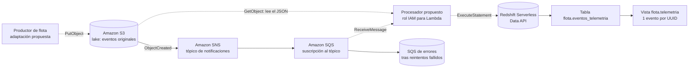

<div align="center">

# Pipeline de Telemetría Vehicular en AWS

**Infraestructura como Código para telemetría vehicular: almacenamiento, mensajería, warehouse e identidad del procesador en AWS**

🎓 Proyecto académico — Big Data, Universidad EIA (2026-2)

[](https://www.terraform.io/)
[](https://registry.terraform.io/providers/hashicorp/aws/latest)
[](https://www.terraform.io/language)
[](https://aws.amazon.com/redshift/redshift-serverless/)

</div>

---

## Tabla de contenido

- [Descripción general](#descripción-general)
- [Arquitectura del pipeline](#arquitectura-del-pipeline)
- [Capas modeladas](#capas-modeladas)
- [Permisos y mínimo privilegio](#permisos-y-mínimo-privilegio)
- [Decisión de diseño: alternativa descartada](#decisión-de-diseño-alternativa-descartada)
- [Escalabilidad ante 100x más datos](#escalabilidad-ante-100x-más-datos)
- [Despliegue real (evidencia)](#despliegue-real-evidencia)
- [Estructura del repositorio](#estructura-del-repositorio)
- [Tecnologías utilizadas](#tecnologías-utilizadas)
- [Instalación y uso](#instalación-y-uso)
- [Contraste con la plantilla de referencia (GCP)](#contraste-con-la-plantilla-de-referencia-gcp)
- [Aprendizajes clave](#aprendizajes-clave)
- [Contexto académico](#contexto-académico)
- [Autores](#autores)

---

## Descripción general

Diseño de un pipeline de datos en la nube como **Infraestructura como Código (IaC)** con Terraform, modelando las cuatro capas de un pipeline moderno — ingesta, almacenamiento (data lake), procesamiento y consumo (warehouse) — sobre **Amazon Web Services**, más los permisos de mínimo privilegio que las conectan.

El caso de uso es la telemetría de una flota simulada de vehículos (velocidad, combustible, ubicación). En el flujo diseñado, un productor adaptado guardaría cada evento en S3, S3 notificaría por SNS y SNS entregaría la referencia a una cola SQS. Un procesador leería el JSON del lake y lo insertaría en Redshift Serverless; el analista consultaría una vista deduplicada.

El repositorio contiene la configuración Terraform, el informe de arquitectura y capturas de validación y despliegue. **El productor adaptado y la función de procesamiento no están implementados**; se modelan sus permisos y la identidad del futuro job. Las evidencias disponibles documentan la creación de infraestructura, sin demostrar procesamiento de telemetría de extremo a extremo.

## Arquitectura del pipeline



Los elementos discontinuos representan la ejecución propuesta. Terraform define el rol IAM y la política del procesador, además de una política para el futuro productor. La adaptación del productor y la función Lambda quedan pendientes; la política del productor aún no se adjunta a una identidad concreta.

## Capas modeladas

| Capa | Servicio AWS | Papel en el pipeline |
|---|---|---|
| **Ingesta** | Amazon SNS (tópico estándar) + Amazon SQS (suscripción) | Publica avisos cuando S3 crea un objeto; desacopla al productor de los consumidores y amortigua picos |
| **Almacenamiento** | Amazon S3 (`bucket_prefix`, privado, cifrado, versionado) | Data lake de eventos originales en JSON; permite reprocesar sin depender de las tablas analíticas |
| **Procesamiento** | Rol IAM (`aws_iam_role` + `aws_iam_role_policy`) | Identidad del futuro job (Lambda) que leería SQS y S3 y cargaría Redshift, con el mínimo acceso necesario |
| **Consumo** | Amazon Redshift Serverless (namespace + workgroup) | Warehouse con tabla `flota.eventos_telemetria` (esquema definido) y vista `flota.telemetria` deduplicada |
| **Red** | VPC + 3 subredes privadas + Security Group sin reglas | Aísla el workgroup de Redshift; sin Internet Gateway ni acceso SQL entrante — las consultas van por Data API |

## Permisos y mínimo privilegio

El principio de mínimo privilegio se aplica limitando las acciones y los recursos a lo que necesita cada identidad. El procesador puede consumir la ingesta, leer los originales y escribir en la tabla; la administración de recursos utiliza una identidad separada.

| Acceso del procesador | Permiso y alcance | Por qué se necesita |
|---|---|---|
| **Consumir la ingesta** | `sqs:ReceiveMessage`, `sqs:DeleteMessage`, `sqs:GetQueueAttributes`, solo en la cola principal | Recibir trabajo y confirmar que terminó; no crea, modifica ni elimina colas |
| **Leer el lake** | `s3:GetObject`, únicamente sobre `raw/flota/*` | La notificación ya da la clave exacta; no necesita listar el bucket ni escribir/borrar originales |
| **Enviar SQL** | `redshift-data:ExecuteStatement` + `redshift-serverless:GetCredentials`, limitado al workgroup del proyecto | Carga datos con credenciales temporales (sin contraseña de usuario propia) |
| **Verificar el resultado** | `redshift-data:DescribeStatement` con condición de propietario de la sentencia | La ejecución es asíncrona; la condición restringe la consulta a las sentencias propias del rol |
| **Escribir en la tabla** | `USAGE` en el esquema `flota` + `INSERT` en `eventos_telemetria`, para el usuario SQL `IAMR:<rol>` | Carga telemetría sin ser administrador: no tiene `SELECT`, `UPDATE`, `DELETE` ni `DROP` |

Las políticas de conexión entre servicios también están acotadas con condiciones (`SourceArn`/`SourceAccount`): S3 solo puede publicar en el tópico propio, y el tópico solo puede entregar a la cola propia, dentro de la misma cuenta.

## Decisión de diseño: alternativa descartada

**Decisión:** SNS con una suscripción SQS para la ingesta, en lugar de mantener **Kafka** mediante **Amazon MSK**, que era el protocolo del productor del trabajo anterior.

Se descartó MSK porque añadiría configuración de conectividad, autenticación y operación de Kafka que no resulta necesaria para el objetivo del taller. SNS+SQS expresa el mismo patrón de tópico/suscripción con servicios administrados, al costo de requerir adaptar el productor actual (que ya no podría usarse sin cambios) y de perder el modelo de consumo por offsets de Kafka — el reproceso se basaría en los originales de S3 en su lugar.

## Escalabilidad ante 100x más datos

El simulador emite ~1 lectura/s de cada uno de 8 vehículos (≈8 eventos/s); 100 veces ese volumen equivale a **≈800 eventos/s**, cifra estimada para discutir el diseño, no resultado de pruebas de carga.

| Pieza | Se mantiene | Habría que ajustar |
|---|---|---|
| S3 | Almacenamiento desacoplado, crece sin cambiar de modelo | Agrupar eventos / evaluar Parquet para lotes analíticos (un JSON por lectura multiplicaría objetos pequeños) |
| SNS + SQS | Desacoplamiento y absorción de picos | Revisar cuotas, antigüedad y cantidad de mensajes pendientes; una cola creciendo indica atraso |
| Procesador | — | Tamaño de lote, concurrencia y duración por ejecución; manejo de fallos parciales |
| Redshift | — | Medir tiempos de carga/consulta antes de subir capacidad; evaluar `COPY` por lotes en vez de inserciones individuales |

## Despliegue real (evidencia)

El despliegue es **opcional** y puede aportar un plus según el enunciado. La captura [`evidencias/terraform-apply.png`](evidencias/terraform-apply.png) muestra la creación exitosa de los recursos definidos en Terraform:

```
terraform apply
...
Apply complete! Resources: 32 added, 0 changed, 0 destroyed.

Outputs:
analytics_relation       = "flota.telemetria"
ingestion_queue_url      = "https://sqs.us-east-1.amazonaws.com/052022403573/flota-telemetria-procesamiento"
lake_bucket_name         = "flota-telemetria-raw-26d9dc7fd1280603c74c42591b"
processor_role_arn       = "arn:aws:iam::052022403573:role/flota-telemetria-procesador"
producer_policy_arn      = "arn:aws:iam::052022403573:policy/flota-telemetria-productor"
warehouse_workgroup_name = "flota-telemetria"
```

La salida muestra **32 recursos añadidos, 0 modificados y 0 destruidos**, e incluye la finalización de las sentencias SQL de creación de la vista y asignación de permisos. Las capturas de consola AWS muestran los servicios del proyecto:

| Evidencia | Archivo |
|---|---|
| Validación obligatoria exitosa | [terraform-validate.png](evidencias/terraform-validate.png) |
| Ejecución exitosa de `terraform apply` | [terraform-apply.png](evidencias/terraform-apply.png) |
| Bucket del lake | [AWS-S3.png](evidencias/AWS-S3.png) |
| Tópico SNS | [AWS-SNS.png](evidencias/AWS-SNS.png) |
| Cola principal y cola de errores | [AWS-SQS.png](evidencias/AWS-SQS.png) |
| Namespace de Redshift Serverless | [AWS-Redshift.png](evidencias/AWS-Redshift.png) |

**Estado de eliminación:** el repositorio no contiene una captura o registro de `terraform destroy`. Estas evidencias no permiten confirmar si los recursos siguen activos ni si existen cargos pendientes. La validación es local; el despliegue sí utiliza servicios AWS y puede generar costos.

## Estructura del repositorio

```
.
├── main.tf                             # Cuatro capas y permisos, comentados
├── README.md                           # Descripción y evidencias disponibles
├── Informe_Arquitectura_Flota_AWS.pdf  # Informe de cinco páginas, incluye evidencia del bonus
├── Trabajo4_Terraform_Enunciado.docx   # Enunciado del taller
├── evidencias/
│   ├── terraform-validate.png          # Validación local exitosa
│   ├── terraform-apply.png             # Creación de 32 recursos
│   ├── AWS-S3.png
│   ├── AWS-SNS.png
│   ├── AWS-SQS.png
│   └── AWS-Redshift.png
├── .terraform.lock.hcl                 # Versión y checksums del proveedor
└── .gitignore
```

## Tecnologías utilizadas

| Categoría | Herramientas |
|---|---|
| IaC | Terraform `>= 1.11.0, < 2.0` |
| Proveedor | `hashicorp/aws ~> 6.0`; versión fijada en el lock: `6.71.0` |
| Ingesta | Amazon SNS (estándar) + Amazon SQS (+ DLQ con redrive policy) |
| Almacenamiento | Amazon S3 (privado, versionado, cifrado SSE, deny de transporte inseguro) |
| Procesamiento | Rol IAM + política inline (identidad del futuro job) |
| Consumo | Redshift Serverless (namespace + workgroup) vía Redshift Data API |
| Red | VPC, 3 subredes privadas, Security Group sin reglas de ingreso/egreso |

## Instalación y uso

```powershell
# 1. Instalar Terraform; el repositorio no incluye el ejecutable
# https://developer.hashicorp.com/terraform/install

# 2. Inicializar el proveedor para validación local
terraform init -backend=false

# 3. Comprobar formato y validar la configuración sin crear recursos
terraform fmt -check
terraform validate
```

La validación comprueba la configuración y el esquema del proveedor; no ejecuta las sentencias SQL ni verifica los permisos efectivos en AWS. Se debe conservar `.terraform.lock.hcl` para reproducir la versión del proveedor.

El despliegue opcional requiere una cuenta y credenciales AWS con permisos de aprovisionamiento. Los siguientes comandos corresponden al despliegue y a la eliminación, no son necesarios para validar:

```powershell
# Revisar los cambios propuestos antes de crear infraestructura
terraform plan

# Crear infraestructura: puede generar costos en AWS
terraform apply

# Eliminar los recursos gestionados desde el mismo estado de Terraform
terraform destroy
```

Antes de considerar cerrado un despliegue, hay que comprobar la finalización de la eliminación y el estado de los servicios en la cuenta utilizada. Eliminar recursos no cancela el consumo ya realizado. El bucket tiene `force_destroy = false`; si contiene objetos o versiones, su eliminación puede requerir gestionarlos previamente.

## Contraste con la plantilla de referencia (GCP)

El taller ofrece una plantilla de referencia sobre Google Cloud (Pub/Sub, Cloud Storage, Service Account, BigQuery). Este proyecto traduce el mismo patrón de 4 capas a sus equivalentes administrados en AWS:

| Capa | Plantilla GCP | Este proyecto (AWS) |
|---|---|---|
| Ingesta | Pub/Sub topic + subscription | SNS topic + SQS subscription |
| Almacenamiento | Cloud Storage bucket | S3 bucket |
| Procesamiento | Service Account | IAM Role |
| Consumo | BigQuery dataset + table | Redshift Serverless namespace/workgroup + tabla |

La decisión de nube (AWS) se sustenta en el informe de arquitectura; el patrón de diseño (desacoplar ingesta de procesamiento, identidad mínima para el job, warehouse con esquema propio) es el mismo que pide la plantilla, solo que expresado con los servicios administrados de AWS.

## Aprendizajes clave

- El mínimo privilegio no es solo una política de "solo lectura": significa enumerar exactamente las acciones y el alcance (`Resource`) que una identidad necesita, y nada más — incluso dentro de un mismo servicio (p. ej., `INSERT` sin `SELECT`/`UPDATE`/`DELETE`/`DROP` en Redshift).
- Las políticas que conectan dos servicios administrados (S3→SNS, SNS→SQS) también deben acotarse con condiciones (`SourceArn`/`SourceAccount`); dejar el principal abierto (`"*"`) sin condición es un error común que una condición cierra sin perder funcionalidad.
- `terraform plan` permite revisar los cambios propuestos antes de `apply`. La evidencia disponible en este repositorio muestra el resultado de `apply` con 32 recursos creados; no se incluye una captura independiente del plan.
- Redshift Serverless con Data API permite ejecutar SQL de administración (crear esquema, tabla, vista, usuario IAMR y permisos) directamente desde Terraform, sin abrir un puerto SQL ni gestionar una conexión JDBC.

## Contexto académico

Desarrollado como Trabajo 4 (evaluación final) de la asignatura Big Data, Universidad EIA (2026-2), prof. Alejandro Mery Agudelo, en parejas. El taller pedía diseñar y sustentar con Terraform una arquitectura de pipeline de datos en la nube (4 capas + IAM), validar la sintaxis con `terraform validate`, y entregar un informe de arquitectura en PDF — el despliegue real era opcional.

## Autores

**Sebastián Giraldo Franco** — [@sebasgiraldo69](https://github.com/sebasgiraldo69)
**Juan José Jaramillo Mora** — [@Juanjo1414](https://github.com/Juanjo1414)
